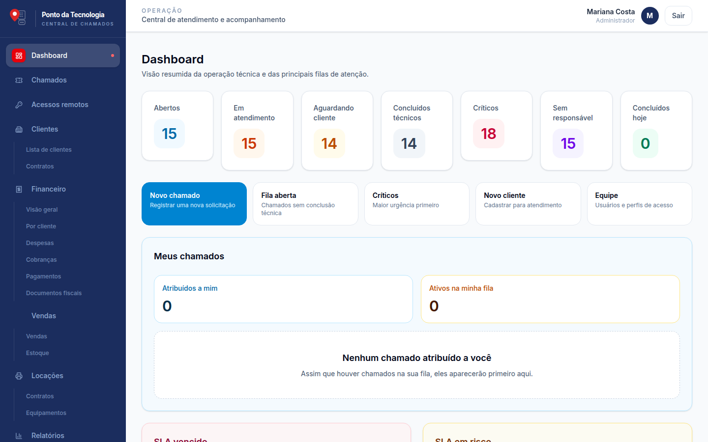
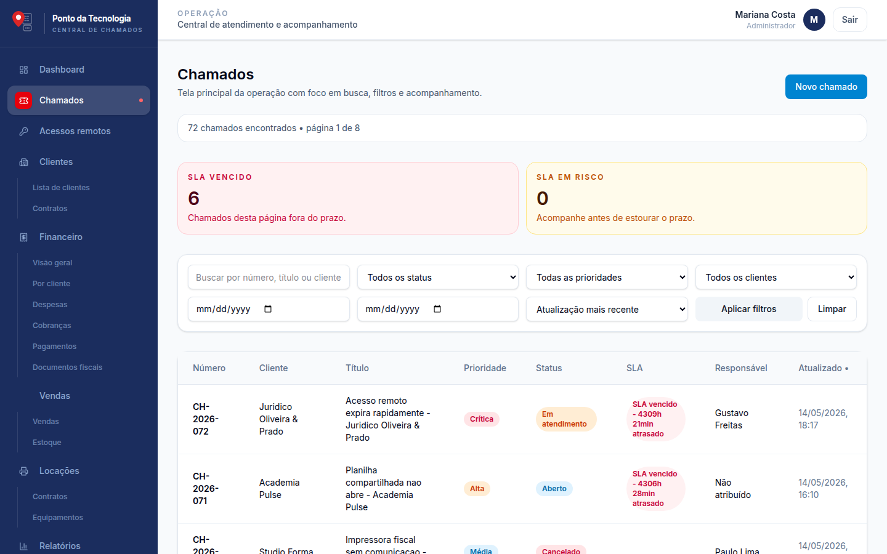
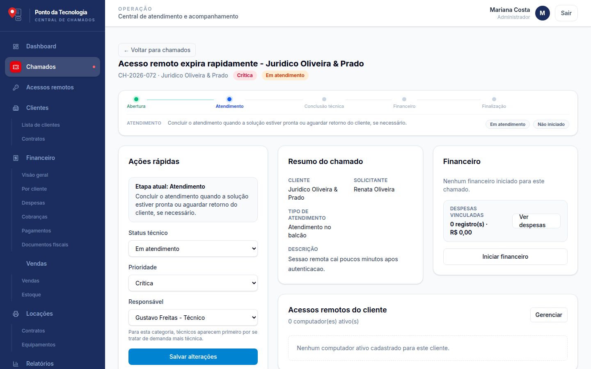
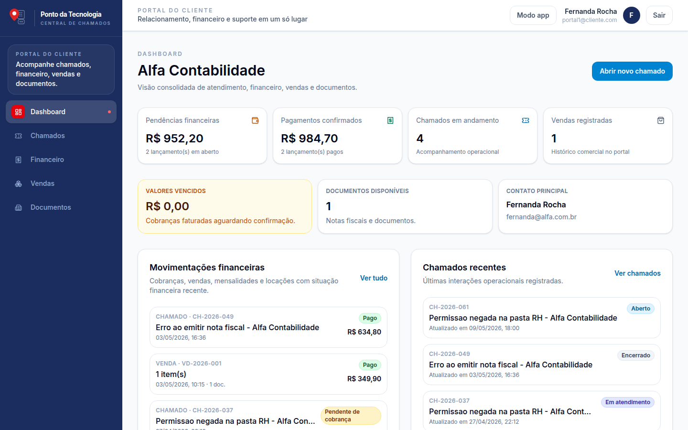

# Central de Chamados — Ponto da Tecnologia

[](https://github.com/romeuroberto/ponto-da-tecnologia-chamados/actions/workflows/ci.yml)

Sistema web interno para registro, acompanhamento e encerramento de chamados de suporte técnico, com módulo financeiro, vendas, controle de estoque e portal do cliente.

**Stack:** Next.js 16 · TypeScript · Prisma · PostgreSQL · Auth.js · Tailwind CSS · Docker · Vitest · GitHub Actions

## Telas

> Capturas feitas com os dados fictícios do seed de desenvolvimento.

| Painel da operação | Lista de chamados |
| --- | --- |
|  |  |
| **Detalhe do chamado** | **Portal do cliente** |
|  |  |

---

## Deploy em produção (Proxmox + Ubuntu 24.04)

### Pré-requisitos

- VM Ubuntu 24.04 no Proxmox
- Disco principal (SSD) para sistema e banco de dados
- Disco secundário (HD mecânico) adicionado à VM para uploads
- Nginx Proxy Manager rodando em outro container/VM com acesso à rede
- Domínio configurado apontando para o IP público do servidor
- Repositório clonado no servidor

---

### 1. Instalar Docker

```bash
curl -fsSL https://get.docker.com | sh
sudo usermod -aG docker $USER
newgrp docker
```

---

### 2. Clonar o repositório

```bash
git clone <url-do-repositorio> /opt/chamados
cd /opt/chamados
```

---

### 3. Preparar os discos de dados

O banco fica no SSD (rápido, crítico para performance) e os uploads no HD mecânico (grande capacidade, acesso não crítico).

#### 3.1 Adicionar o HD mecânico à VM

No Proxmox, acesse a VM → **Hardware → Add → Hard Disk**, selecione o storage do HD mecânico e defina o tamanho. Inicie a VM.

#### 3.2 Formatar e montar o HD mecânico

Dentro do Ubuntu, identifique o novo disco (geralmente `/dev/sdb` ou `/dev/vdb`):

```bash
lsblk
```

Formate e monte permanentemente:

```bash
# Criar partição e sistema de arquivos
sudo parted /dev/sdb mklabel gpt
sudo parted /dev/sdb mkpart primary ext4 0% 100%
sudo mkfs.ext4 /dev/sdb1

# Criar ponto de montagem
sudo mkdir -p /mnt/hd

# Obter o UUID do disco
sudo blkid /dev/sdb1
# Copie o UUID exibido, ex: UUID="xxxxxxxx-xxxx-xxxx-xxxx-xxxxxxxxxxxx"

# Adicionar ao fstab para montar automaticamente no boot
echo 'UUID=SEU_UUID_AQUI /mnt/hd ext4 defaults,nofail 0 2' | sudo tee -a /etc/fstab

# Montar agora
sudo mount -a
```

#### 3.3 Criar os diretórios de dados

```bash
# Banco de dados → SSD (disco principal da VM)
sudo mkdir -p /opt/chamados-data/postgres
sudo chown -R 999:999 /opt/chamados-data/postgres

# Uploads → HD mecânico
sudo mkdir -p /mnt/hd/chamados/uploads
sudo chown -R 1001:1001 /mnt/hd/chamados/uploads
```

---

### 4. Criar o arquivo de variáveis de ambiente

```bash
cd /opt/chamados
cp .env.production.example .env.production
nano .env.production
```

Preencher o arquivo:

```env
# Banco de dados
POSTGRES_DB=ticket_system
POSTGRES_USER=postgres
POSTGRES_PASSWORD=senha_forte_aqui

# Aplicação
AUTH_SECRET=   # gerar com: openssl rand -base64 32
AUTH_URL=https://chamados.seudominio.com.br

# Banco → SSD (dentro do LXC)
DB_STORAGE_PATH=/opt/chamados-data/postgres

# Uploads → HD mecânico (montado no LXC)
UPLOADS_STORAGE_PATH=/mnt/hd/chamados/uploads
```

Gerar o `AUTH_SECRET`:

```bash
openssl rand -base64 32
```

---

### 5. Primeiro deploy

```bash
chmod +x deploy.sh
./deploy.sh
```

O script irá:
1. Fazer `git pull` do código mais recente
2. Construir a imagem Docker (instala dependências, gera Prisma client, build Next.js)
3. Subir os containers de banco e aplicação
4. Executar automaticamente as migrações do banco ao iniciar

O primeiro build leva alguns minutos. Acompanhe os logs:

```bash
docker compose -f docker-compose.prod.yml logs -f app
```

---

### 6. Criar o usuário administrador inicial

Após os containers estarem rodando, execute o seed para criar o usuário admin padrão:

```bash
docker compose -f docker-compose.prod.yml exec app node prisma/seed.js
```

> As credenciais iniciais estão definidas no arquivo `prisma/seed.js`. Altere a senha após o primeiro acesso.

---

### 7. Configurar o Nginx Proxy Manager

No painel do Nginx Proxy Manager, adicionar um novo **Proxy Host**:

| Campo | Valor |
|---|---|
| Domain Names | `chamados.seudominio.com.br` |
| Scheme | `http` |
| Forward Hostname / IP | IP do LXC Ubuntu no Proxmox |
| Forward Port | `3000` |
| Websockets Support | Ativado |

Na aba **SSL**:
- Selecionar **Request a new SSL Certificate**
- Ativar **Force SSL**
- Ativar **HTTP/2 Support**

---

### 8. Atualizações futuras

Para atualizar a aplicação após novos commits no repositório:

```bash
cd /opt/chamados
./deploy.sh
```

O script puxa o código novo, rebuilda a imagem e reinicia os serviços. As migrações de banco são aplicadas automaticamente no startup.

---

## Desenvolvimento local

### Pré-requisitos

- Node.js 20+
- Docker (para o banco de dados)

### Configuração

```bash
# Instalar dependências
npm install

# Subir o banco de dados local
docker compose up -d

# Copiar e preencher as variáveis de ambiente
cp .env.example .env
# Editar .env com as credenciais locais

# Aplicar migrações e seed
npx prisma migrate deploy
node prisma/seed.js

# Iniciar o servidor de desenvolvimento
npm run dev
```

Acesse em [http://localhost:3000](http://localhost:3000).

### Comandos úteis

```bash
# Regenerar o Prisma client após mudanças no schema
# (parar o servidor antes no Windows)
npx prisma generate

# Criar nova migração
npx prisma migrate dev --name descricao_da_mudanca

# Abrir o Prisma Studio (interface visual do banco)
npx prisma studio
```

### Qualidade

```bash
npm run lint       # ESLint (regras do Next.js)
npm run typecheck  # checagem de tipos com tsc
npm test           # testes unitários com Vitest
```

Os testes ficam ao lado do código (`*.test.ts`) e cobrem as regras de negócio puras: SLA, fluxo do chamado, matriz de permissões, travas do financeiro, formatação e validações. O workflow [`.github/workflows/ci.yml`](.github/workflows/ci.yml) roda lint, checagem de tipos e testes em cada push e pull request.

---

## Estrutura de diretórios relevante

```
├── prisma/
│   ├── schema.prisma       # Modelo de dados
│   ├── migrations/         # Histórico de migrações SQL
│   └── seed.js             # Dados iniciais (usuário admin)
├── src/
│   ├── app/                # Rotas Next.js (App Router)
│   │   ├── (dashboard)/    # Área interna (admin/atendente/técnico)
│   │   ├── portal/         # Portal do cliente
│   │   └── api/            # API Routes
│   ├── components/         # Componentes React
│   ├── server/             # Repositórios, serviços, autenticação
│   └── types/              # Tipos TypeScript globais
├── Dockerfile
├── docker-compose.prod.yml # Compose de produção
├── docker-compose.yml      # Compose local (apenas banco)
├── deploy.sh               # Script de atualização
└── .env.production.example # Template de variáveis de produção
```

---

## Perfis de acesso

| Perfil | Acesso |
|---|---|
| `ADMIN` | Acesso total ao sistema |
| `ATTENDANT` | Chamados, financeiro, clientes, vendas |
| `TECHNICIAN` | Chamados e ordens de serviço |
| `CLIENT` | Portal do cliente (`/portal`) |
